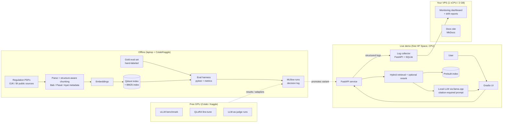

# EasyPasal — Implementation Plan

> **One-line pitch:** An evaluation-first, citation-grounded assistant that answers Indonesian financial-regulation questions (Bahasa Indonesia + English) from real public OJK / Bank Indonesia documents, built and operated like a production LLM system: offline evals, a CI ship/no-ship gate, A/B-style variant comparison, live monitoring, optimized inference, and prompt optimization.
>
> **Tagline for README:** *Evaluated, cited answers on Indonesian financial regulation.*
>
> **Status:** Draft v1 · Created 2026-10-10
>
> **Independence notice (must appear in README + UI):** EasyPasal is an independent portfolio project. It is not affiliated with, endorsed by, or representing OJK or Bank Indonesia, and it does not provide legal advice.

---

## 1. Goal and non-goals

### Goal
Produce a public GitHub repository and live demo that let a recruiter, a hiring manager, and a technical interviewer each see — within minutes — evidence that the author can **own an LLM workflow end to end (design, build, deploy, monitor)** and **build the evaluation layer that decides what ships**.

### Non-goals (explicitly out of scope)
- A credit-scoring model (mentioned only as a future extension in the stakeholder memo).
- Anything using proprietary or customer data. Only public regulations and author-created evaluation data.
- Claiming real customer traffic or enterprise production use. The project is *production-style*, and every claim in the docs must be true (see §13).
- Training a model from scratch.

---

## 2. Requirement → deliverable map

| Job posting line | EasyPasal deliverable | Evidence a reviewer can open |
|---|---|---|
| Own production AI/LLM workflows end to end: design, build, deploy, monitor | Dockerized RAG service, live demo, log collector, monitoring dashboard, rollback procedure | Live demo URL, `docker-compose.yml`, `docs/runbook.md` |
| Build the evaluation layer that decides what ships: offline evals, A/B tests, live monitoring | Hand-built gold set, metric suite, CI eval gate, variant comparison with confidence intervals, replay-based A/B, monitoring dashboard | `eval/`, GitHub Actions run, `docs/decision-log.md` |
| Optimize inference with vLLM | vLLM serving benchmark (throughput/latency vs concurrency) against a CPU llama.cpp baseline | `benchmarks/vllm/`, results table in README |
| Prompt optimization frameworks (GEPA or similar) | DSPy + GEPA run optimizing the answer prompt against the gold set (train/dev/test split) | `experiments/gepa/`, before/after metrics |
| Fine-tuning (LoRA/QLoRA), financial use cases | One narrow QLoRA fine-tune on a financial-regulation task (see E7) | `experiments/qlora/`, adapter card, before/after metrics |
| Translate trade-offs for Product, Risk, Compliance | 1–2 page stakeholder memo + plain-language results summary | `docs/stakeholder-memo.md` |
| Strong Python fundamentals | Typed, tested, linted package with CI | `src/easypasal/`, `tests/`, ruff/pytest badges |
| Banking / fintech background (bonus) | Regulatory-compliance domain: consumer protection, IT risk, AML/CFT, personal data | Corpus manifest in `data/corpus_manifest.csv` |

---

## 3. System architecture



**Design principles**
1. **Evals decide what ships.** No variant is promoted without a logged comparison on the held-out test split; the CI gate enforces minimum thresholds.
2. **Grounded or silent.** The assistant must cite regulation, article (pasal) and clause (ayat), or say it cannot find a legal basis. Abstention is a measured behavior, not a failure.
3. **Fit the hardware.** Nothing requires a GPU on the laptop or VPS. GPU work is isolated to reproducible notebooks/scripts that run on free Colab/Kaggle.
4. **Separation of concerns.** App (demo host) ≠ log sink/dashboard (VPS) ≠ offline experiments. This mirrors a real deployment and makes the monitoring story honest.
5. **Reproducible.** Every number in the README can be regenerated with one documented command and a pinned config.

---

## 4. Tech stack (free, open-source, market-standard)

> **Versions and model names must be verified in Phase 0** against current releases (my knowledge may be out of date). Pin exact versions in `pyproject.toml` / `uv.lock` once chosen.

| Layer | Choice | Why this one | Alternatives considered |
|---|---|---|---|
| Language / env | Python 3.11+, **uv**, ruff, mypy (light), pytest, pre-commit | Fast, standard modern Python tooling; shows fundamentals | poetry, pip-tools |
| PDF parsing | **PyMuPDF** | Fast, reliable text + layout extraction for Indonesian regulation PDFs | pdfplumber, Docling (heavier), OCR only if scanned |
| Chunking | Custom **structure-aware** splitter (Bab → Bagian → Pasal → Ayat), with fixed-size baseline for comparison | Legal text has natural units; enables precise citations | LangChain/LlamaIndex splitters |
| Vector DB | **Qdrant** (local/embedded mode; Docker for full mode) | Popular open-source standard, hybrid-friendly, runs light | pgvector, Chroma, FAISS |
| Sparse retrieval | **BM25** (e.g., `bm25s` or `rank_bm25`) | Exact matching on pasal numbers and legal terms | OpenSearch (too heavy for 2 GB) |
| Fusion | Reciprocal Rank Fusion | Simple, strong baseline | Weighted score fusion |
| Embeddings | Candidates: **BGE-M3**, multilingual-e5 (small/base), plus any newer strong multilingual model found in Phase 0 | Multilingual with good Indonesian support; experiment E2 decides | Indonesian-specific models |
| Reranker (optional) | Candidate: bge-reranker family | Tested in E3; keep only if it earns its latency | none |
| Generation (CPU, demo) | Small open-weight instruct model, 4-bit GGUF via **llama.cpp** (`llama-cpp-python`) or **Ollama** | Runs on a CPU-only laptop and a free CPU Space | Cloud APIs (breaks open-source/self-host story) |
| Model shortlist | Latest small Qwen instruct, Gemma, Llama, and Indonesian-tuned options (e.g., SEA-LION, Sahabat-AI) — verify current availability/licenses | Indonesian quality is the deciding factor (E4) | — |
| Orchestration | **Thin custom pipeline** (plain Python) | Fewer moving parts, easier to evaluate and explain; avoids framework lock-in | LlamaIndex, LangChain |
| High-throughput serving | **vLLM** on free Colab/Kaggle GPU | Directly named in posting; benchmark vs CPU baseline | TGI, SGLang |
| Prompt optimization | **DSPy** with **GEPA** optimizer | Directly named in posting | manual prompt iteration (baseline) |
| Fine-tuning | **QLoRA** via **PEFT + TRL** (Unsloth optional for speed on free GPUs) | Standard stack; fits free GPU memory | full fine-tune (too heavy) |
| API | **FastAPI** + Pydantic | Standard, typed, easy to test | Flask |
| Demo UI | **Gradio** | Native fit for Hugging Face Spaces; quick citation display + feedback buttons | Streamlit |
| Eval metrics | Custom deterministic metrics + **RAGAS** and/or **DeepEval** for LLM-judged metrics | Combines cheap, trustworthy checks with judged quality | TruLens |
| Experiment tracking | **MLflow** (file backend) | Standard, light, free | Weights & Biases (not fully OSS) |
| Monitoring | Structured JSON logs → SQLite on VPS; **Evidently** reports; small dashboard (Streamlit or Gradio tab) | Fits 2 GB RAM; honest, simple | Langfuse/Grafana stack (likely too heavy for 2 GB — verify) |
| CI/CD | **GitHub Actions** | Free for public repos | — |
| Packaging | **Docker** + docker-compose | You already use Docker | — |
| Docs | **MkDocs Material** on VPS (or GitHub Pages) | Clean, fast | Sphinx |
| License | **Apache-2.0** | Explicit patent grant, enterprise-friendly | MIT |

---

## 5. Data plan

### 5.1 Corpus (real, public)
Build a **focused** corpus of roughly 15–30 documents across four themes that are relevant to a bank. Final list is created in Phase 0 and recorded in `data/corpus_manifest.csv` (title, number/year, issuer, URL, retrieval date, status, language, hash).

Candidate themes and examples to **verify for current number, amendment, and status** before use:

| Theme | Examples to check (verify current status) |
|---|---|
| Consumer protection in financial services | POJK on consumer and public protection in the financial services sector (recent regulation; confirm current number/year) |
| IT / operational risk for banks | POJK on IT implementation by commercial banks; related SEOJK |
| AML / CFT (anti-money-laundering, counter-terror-financing) | POJK on AML/CFT program in financial services; related circulars |
| Personal data protection | The Personal Data Protection Law (UU PDP) and OJK guidance relevant to financial institutions |

**Sources:** OJK regulation portal, Bank Indonesia regulation portal, and the national legal database JDIH. Record the retrieval date for every file. Public regulations are generally publishable, but note each source's terms in the manifest.

**Rules**
- Only use documents currently in force, or record superseded status explicitly in metadata (`status: berlaku | dicabut | diubah`) — superseded text is a deliberate test case for the eval set.
- Do not commit large raw PDFs if licensing or size is unclear; commit the manifest + download script instead.
- Keep a `data/README.md` describing provenance.

### 5.2 Gold evaluation set (author-labeled)
Target **150–200 Q/A items** (minimum viable: 100). Each item:

```json
{
  "id": "q-0042",
  "lang": "id",
  "category": "single_hop | multi_hop | comparison | definition | unanswerable | superseded | adversarial",
  "question": "...",
  "gold_answer": "...",
  "gold_citations": [{"doc_id": "...", "pasal": "…", "ayat": "…"}],
  "answerable": true,
  "notes": "..."
}
```

**Composition guideline (adjust as needed)**

| Category | Share | Purpose |
|---|---|---|
| Single-hop factual | 35% | Baseline retrieval + grounding |
| Multi-hop / cross-article | 15% | Retrieval depth |
| Definitions / terms | 10% | Terminology coverage |
| Comparison across regulations | 10% | Reasoning over multiple sources |
| Unanswerable (no basis in corpus) | 15% | Abstention behavior |
| Superseded / outdated rule traps | 5% | Correct handling of regulation status |
| Adversarial (prompt injection, request for legal advice, off-topic) | 10% | Safety and scope control |

- **Splits:** `train` (for GEPA/fine-tune, ~40%), `dev` (for iteration, ~30%), `test` (held out, ~30%). The `test` split is **never** used for tuning and is only run for final variant decisions and release gates.
- **English slice:** include ~20–30 English questions to test cross-lingual behavior.
- **Quality control:** you label everything; spot-check 20% a second time after a few days (self-agreement), and log the agreement rate.
- Items are drafted with help from the model **only as a convenience** — you verify every gold answer and citation against the source text.

---

## 6. Evaluation design (the centerpiece)

### 6.1 Metrics

| Level | Metric | Type |
|---|---|---|
| Retrieval | Recall@k, MRR, nDCG@k against gold pasal/ayat | Deterministic |
| Citation | Citation precision, citation recall (does the answer cite the right articles?) | Deterministic |
| Generation | Faithfulness / groundedness to retrieved text | LLM-judged (+ human calibration) |
| Generation | Answer correctness vs gold answer | LLM-judged (+ human calibration) |
| Behavior | Abstention accuracy on unanswerable items; false-abstain rate on answerable items | Deterministic given labels |
| Safety | Pass rate on adversarial items | Rule + judged |
| Ops | p50/p95 latency, tokens/s, memory, cost per 1,000 queries (compute-time based) | Measured |

### 6.2 Judge calibration (do not skip)
LLM judges are only useful if calibrated. Label ~30–40 outputs by hand, compare with the judge, and report agreement (e.g., Cohen's kappa) in the docs. Run the judge on a stronger open-weight model on free GPU, not the tiny demo model. Report judge limitations plainly.

### 6.3 Statistical hygiene
- Compare variants on the same items (paired).
- Report bootstrap confidence intervals; do not claim a win inside the noise.
- Report per-category results, not only the average.

### 6.4 The "A/B" story — stated honestly
There will be no meaningful real traffic, so a real online A/B test would be underpowered. The plan delivers:
1. **Offline paired comparison** (primary evidence for decisions).
2. **Replay-based A/B simulation**: logged queries replayed against variants A and B, with the same judge.
3. **Traffic-splitting mechanism in the API** (header/flag + deterministic hashing) and logging of the variant, demonstrated on a small, clearly labeled demo run.
The docs will say exactly this — never "ran an A/B test on users."

### 6.5 CI ship/no-ship gate
GitHub Actions runs on every PR:
- Unit tests, lint, type checks.
- A **small smoke eval** (e.g., 30 fixed items, retrieval + deterministic metrics only, no GPU) with thresholds, e.g. Recall@5 and citation recall must not drop by more than an agreed margin versus the stored baseline.
- Full eval (judged) is run manually/on-demand on Colab/Kaggle and logged to MLflow and the decision log.

---

## 7. Experiments and decision log

Each experiment produces: hypothesis, config, results table on `dev`, final check on `test`, **decision**, and trade-off notes in plain language. Stored in `docs/decision-log.md`.

| ID | Question | Variants | Decision criterion |
|---|---|---|---|
| E1 | Chunking strategy | Fixed-size vs structure-aware (Pasal/Ayat) vs structure-aware + context header | Recall@k, citation recall |
| E2 | Embedding model | 2–3 multilingual candidates | Recall@k vs indexing/query cost on CPU |
| E3 | Retrieval pipeline | Dense vs BM25 vs hybrid vs hybrid + rerank | Quality gain vs added latency |
| E4 | Generator model | 2–4 small open-weight models, 4-bit | Faithfulness + Indonesian quality vs latency/memory |
| E5 | Prompt design and **GEPA** | Hand-written baseline vs GEPA-optimized prompt | Test-split gain with CI; prompt overfit check |
| E6 | **vLLM** serving benchmark (free GPU) | vLLM vs llama.cpp CPU baseline; concurrency 1/4/16/32 | Throughput, TTFT, p95 latency, memory |
| E7 | **QLoRA** fine-tune (narrow task) | Base vs fine-tuned | Task metric gain; no regression on other categories |

**E7 task options (choose in Phase 6 based on remaining time; recommendation first):**
1. **Question router/classifier** (regulation theme + answerable/unanswerable + injection detection) — small, measurable, useful in the pipeline.
2. **Query rewriting** for Indonesian regulatory phrasing (improves retrieval).
3. **Citation-grounded answer style** — highest effort/risk; only if time permits.

---

## 8. Application design

### 8.1 Request flow
1. Receive question (`/ask`, optional `variant` flag).
2. Guardrail check (scope/injection heuristics, later the E7 router).
3. Hybrid retrieval → fusion → optional rerank → top-k passages with metadata.
4. Prompt assembly: system rules (cite-or-abstain, answer in the user's language, no legal advice) + passages.
5. Generation → parse citations → verify cited pasal exist in retrieved set (post-hoc grounding check).
6. Return answer, citations with source links, confidence/abstain flag; log everything.

### 8.2 Response schema (sketch)
```json
{
  "answer": "...",
  "language": "id",
  "citations": [{"doc_id": "...", "title": "...", "pasal": "...", "ayat": "...", "url": "...", "snippet": "..."}],
  "abstained": false,
  "variant": "A",
  "latency_ms": 1234,
  "request_id": "..."
}
```

### 8.3 UI (Gradio)
Chat box, language toggle, collapsible citations with source links, thumbs up/down, "report wrong answer," and a visible disclaimer banner.

---

## 9. Monitoring and operations

**Logged per request:** request ID, timestamp, variant, language, question length, retrieval scores (top-1/top-k), retrieved doc IDs, abstain flag, latency (retrieval/generation/total), token counts, user feedback. Avoid storing sensitive personal data; add a notice in the UI that questions are logged for evaluation and truncate/redact obvious personal identifiers.

**Dashboards / reports (on VPS)**
- Latency p50/p95 over time, request volume, abstain rate.
- Retrieval-score distribution and "low-evidence answer" rate.
- Query-topic drift (embedding-based or keyword-based) vs the gold-set distribution (Evidently).
- User feedback rate and negative-feedback samples for review.

**Alerting (lightweight):** threshold checks (e.g., abstain rate or p95 latency beyond limits) that write a flagged event and open a GitHub issue or send a notification via a free webhook.

**Runbook (`docs/runbook.md`):** how to roll back to the previous variant, how to rebuild the index, how to rotate the model, known failure modes.

**Memory budget on the 2 GB VPS:** only the log collector, SQLite, dashboard, and docs run there. No embedding models or LLMs.

---

## 10. Deployment plan

| Component | Host | Notes |
|---|---|---|
| Gradio + FastAPI + retrieval + CPU LLM | **Free Hugging Face Space** (Docker or Gradio SDK) | Verify current free-tier specs, sleep behavior, and storage persistence before relying on it |
| Log collector + dashboard + docs | **Your VPS** | Reverse proxy (e.g., Caddy) with HTTPS if a domain is available |
| Offline experiments | Laptop + Colab/Kaggle | Notebooks and scripts committed with pinned configs |
| Fallback demo | Laptop `docker compose up` + recorded video | For interviews if the Space is down |

**Rollback:** the app reads the active variant from a config file in the repo; rolling back means reverting a commit and redeploying.

---

## 11. Repository structure

```
easypasal/
├── README.md                    # pitch, results table, live demo link, quickstart
├── LICENSE                      # Apache-2.0
├── pyproject.toml / uv.lock
├── Makefile                     # make setup | ingest | index | eval | serve | bench
├── docker-compose.yml
├── .github/workflows/ci.yml     # lint, tests, smoke eval gate
├── configs/                     # variant configs (A/B), model + retrieval settings
├── data/
│   ├── corpus_manifest.csv
│   ├── README.md
│   └── gold/                    # gold_{train,dev,test}.jsonl
├── src/easypasal/
│   ├── ingest/                  # download, parse, chunk
│   ├── index/                   # embeddings, qdrant, bm25
│   ├── retrieval/               # hybrid, fusion, rerank
│   ├── generation/              # prompts, llm client, citation parsing
│   ├── guardrails/              # scope/injection checks, router
│   ├── api/                     # FastAPI app, schemas, logging
│   └── ui/                      # Gradio app
├── eval/
│   ├── metrics/                 # deterministic + judged
│   ├── run_eval.py
│   ├── judge_calibration/
│   └── reports/                 # generated tables/plots
├── experiments/
│   ├── e1_chunking/ ... e5_gepa/ e7_qlora/
├── benchmarks/vllm/             # colab/kaggle notebooks + results
├── monitoring/                  # collector, dashboard, evidently reports
├── docs/
│   ├── architecture.md
│   ├── decision-log.md
│   ├── eval-methodology.md
│   ├── stakeholder-memo.md
│   ├── runbook.md
│   └── reproduce.md             # "how to reproduce this" tutorial
└── tests/
```

---

## 12. Milestones (recommended schedule)

| Milestone | Target date | Outcome |
|---|---|---|
| M0 Setup + corpus | Oct 10–11 | Repo, tooling, CI skeleton, corpus manifest, models shortlist verified |
| M1 Baseline RAG | Oct 13 | Ingest → index → answer with citations, running locally |
| M2 Gold set v1 | Oct 15 | ≥100 labeled items with splits |
| M3 Eval harness + CI gate | Oct 17 | One command runs metrics; CI smoke gate green |
| M4 Core experiments | Oct 19 | E1–E4 decided and logged |
| M5 GEPA + vLLM | Oct 21 | E5 and E6 results logged |
| M6 Monitoring + deploy | Oct 23 | Live demo + log collector + dashboard working |
| M7 QLoRA (stretch) | Oct 23–24 | E7 done, or explicitly descoped |
| M8 Polish | Oct 24 | README, memo, decision log, demo video, reproduce guide complete |

### Priority tiers (cut line if time runs short)
- **P0 (must ship):** corpus, baseline RAG, gold set, eval harness, CI gate, live demo, monitoring, stakeholder memo, decision log (E1–E4).
- **P1 (strongly desired):** E5 GEPA, E6 vLLM benchmark.
- **P2 (stretch):** E7 QLoRA, drift reports, replay A/B demo.

If behind, drop P2 first and say so in the docs ("future work"). Never fake a result.

---

## 13. Honest-claims guide (for README, resume, and interviews)

**OK to say**
- "Built a production-style RAG system with offline evals, a CI gate, monitoring, and a live demo."
- "Benchmarked vLLM against a CPU baseline on a free GPU and report throughput/latency."
- "Applied GEPA prompt optimization against a held-out test split; here are the before/after results with confidence intervals."

**Do not say**
- "Deployed to production for customers / served real users at scale."
- "A/B tested with real users" (unless a real, labeled test happened).
- "Fine-tuned for banking" if E7 is a narrow, small-scale experiment — say exactly what it is.

---

## 14. Risks and mitigations

| Risk | Impact | Mitigation |
|---|---|---|
| Indonesian quality of small models is weak | Poor answers | E4 compares Indonesian-capable models; abstain-by-default prompt; retrieval-heavy design |
| Gold-set labeling takes longer than planned | Delays everything | Start M2 early; minimum viable 100 items; label in short daily batches |
| Free HF Space limits (sleep, RAM, storage) | Demo flakiness | Verify limits early; prebuilt index in the image; fallback video + local compose |
| Free GPU quotas/session limits | Blocks E5–E7 | Small, resumable runs; save checkpoints; cap experiment sizes |
| Regulation versions/amendments confuse answers | Wrong citations | Status metadata + "superseded" test category + show effective date in UI |
| LLM-judge unreliability | Misleading metrics | Calibration against human labels; deterministic metrics as primary |
| Scope creep | Misses deadline | Priority tiers; descope QLoRA first |
| Name or trademark clash | Rework | Check GitHub/PyPI/web search for "EasyPasal" before publishing |
| Mistaken legal impression | Reputation risk | Disclaimer in README/UI; no legal advice; independence notice |

---

## 15. Definition of done

- [ ] Public repo, Apache-2.0, CI badge green, README with results table and live demo link.
- [ ] Live demo reachable, with citations and disclaimer, plus fallback video.
- [ ] Gold set (≥100 items) with splits; judge calibration reported.
- [ ] Decision log with E1–E4 (P0) and E5–E6 (P1) documented; E7 documented or explicitly descoped.
- [ ] Monitoring dashboard live with real (even if small) logged traffic.
- [ ] Stakeholder memo (1–2 pages) and reproduce guide published.
- [ ] Every README claim matches §13.
- [ ] Resume and LinkedIn updated for a Data Scientist (LLM systems) focus.

---

## 16. Items to verify in Phase 0

1. Current names, versions, and licenses of candidate generator and embedding models (including Indonesian-tuned ones).
2. Current free Hugging Face Space specs, sleep policy, and persistence.
3. Current status, numbers, and amendments of each regulation chosen for the corpus.
4. Whether Langfuse/Grafana-style stacks fit the 2 GB VPS (assumed no).
5. Current free GPU quotas on Colab and Kaggle.
6. Availability of the name "EasyPasal" on GitHub, PyPI, and via web search.
